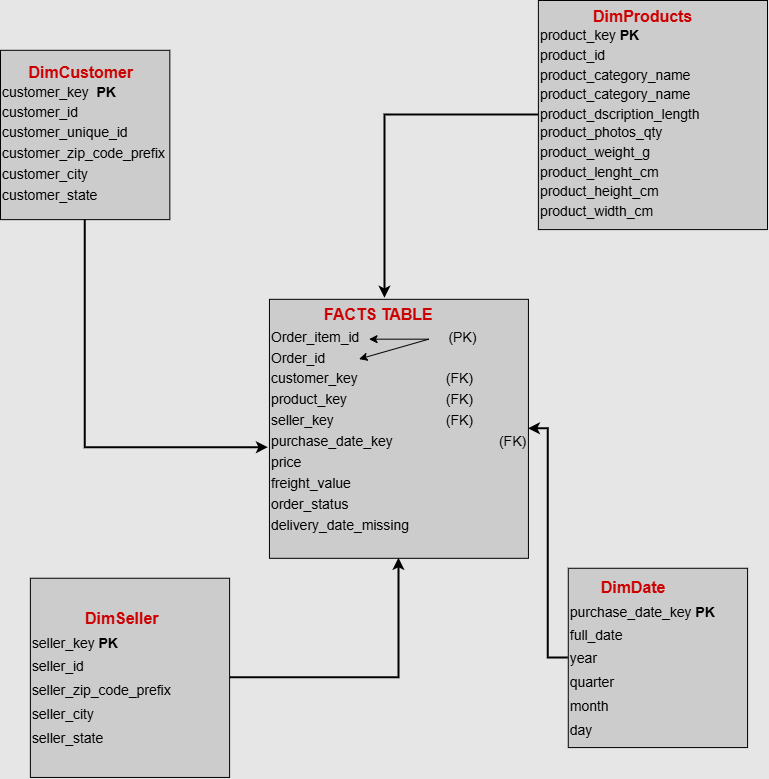

# Olist E-Commerce Data Pipeline

This project is an end-to-end data pipeline that loads the public Olist Brazilian e-commerce dataset into PostgreSQL, checks its quality, models it as a star schema, and produces sales reports. One command rebuilds everything from the raw files.

**Tools:** Python (pandas, SQLAlchemy), PostgreSQL, SQL, Git.

## Architecture



The data moves through three layers namely Raw, core and Reports with each in its own PostgreSQL schema:

| Layer | Schema | What it holds |
|---|---|---|
| Raw | `raw` | The nine CSV files exactly as they arrived |
| Core | `core` | A star schema: `fact_order_items` with `dim_customer`, `dim_product`, `dim_seller` and `dim_date` |
| Reports | `reports` | Views that answer business questions |


## How to run

### Requirements
- Python 3.10 or later
- PostgreSQL (tested with 9.15) and a tool to run SQL, such as pgAdmin
- Git

### 1. Get the project
```
git clone https://github.com/https://github.com/Richie-code631/olist-pipeline.git
cd olist-pipeline
```

### 2. Create the database and schemas
In pgAdmin (or `psql`), create a database named `olist_db`. Then open a Query Tool on that database and run:
```sql
CREATE SCHEMA raw;
CREATE SCHEMA core;
CREATE SCHEMA reports;
```

### 3. Download the data
Download the [Brazilian E-Commerce Public Dataset by Olist](https://www.kaggle.com/datasets/olistbr/brazilian-ecommerce) from Kaggle and unzip the nine CSV files into `data/raw/`. The data is licensed CC BY-NC-SA 4.0 and is not included in this repository.

### 4. Configure the database connection
Copy the example settings file and put your own PostgreSQL password in it:
```
copy .env.example .env
```
Then open `.env` and replace `your_password_here` with your password. If your user, port or database name differ, change them too. The `.env` file is ignored by Git, so your password is never committed.

### 5. Install the Python packages
```
python -m venv .venv
.venv\Scripts\activate
pip install -r requirements.txt
```
On macOS or Linux, use `source .venv/bin/activate` and `cp .env.example .env`.

### 6. Run the pipeline
From the project root, with the environment active:
```
python src/run_pipeline.py
```
This takes a minute or two. It runs these steps in order:
1. `src/load_raw.py` loads the nine CSV files into the `raw` schema, as they arrived.
2. `sql/core_dimensions.sql` rebuilds the star schema in `core`: four dimensions and the fact table.
3. `sql/reports.sql` recreates the report views in `reports`.

The pipeline can be run again at any time. Each run drops and rebuilds the tables and views.

### 7. Check the result
Run `sql/checks_core.sql` in pgAdmin. Expected results:
- `core.fact_order_items` has 112,650 rows
- total price is 13,591,643.70 in both `raw.order_items` and `core.fact_order_items`
- 8 items are flagged with `delivery_date_missing`

The sum of `revenue` in each report view is 13,221,498.11 (delivered orders only).


## Data quality findings

1. **Duplicate order IDs.** The check found 0 duplicates, so `order_id` is the primary key of orders.
2. **Orphan order items.** The check found 0 order items without a matching order, so joins between order items and orders are safe.
3. **Delivered before purchased.** The check found 0 orders with a delivery date earlier than the purchase date, so no timestamp corrections are needed.
4. **Delivered orders with no delivery date.** The check found 8 of 96,478 delivered orders with no delivery date. Decision: keep them in `core` and add a flag column (`delivery_date_missing`), so revenue totals stay complete and delivery-time reports can exclude them.
5. **Canceled orders with a delivery date.** The check found 6 of 625 canceled orders with a delivery date. The data doesn't explain why, so they are kept as they are and noted for review.
6. **Products with no category name.** 610 of 32,951 products (1.9%) have no category name, affecting 1,603 of 112,650 order items (1.4%). Decision: keep the value empty in core and show it as “unknown” in reports. As such, core stays intact as the source recorded it and the report decides how it must be displayed.


## Revenue rule

Only items on orders with status `delivered` count as revenue. This excludes about 370,000 of price (370,145.59) in canceled, unavailable and in-progress orders. Reason: revenue should include only completed sales, so orders that were canceled, are unavailable, or may still change are not counted in the `price` measure.

## Reports

All reports are views in the `reports` schema and count only items on `delivered` orders (see Revenue rule).

- **`revenue_by_category_month`:** revenue and items sold per product category per month. Products with no category are shown as "unknown".
- **`revenue_by_sellers_month`:** revenue and items sold per seller per month, using only the fact table, `dim_seller` and `dim_date`.
- **`customer_orders`:** orders and revenue per real customer (`customer_unique_id`). 2,801 of 93,358 customers (about 3.0%) ordered more than once.


## Design decisions

- **Fact table grain:** one row per order item, because that is where `price` and `freight_value` are.
- **Surrogate keys** in every dimension, so the warehouse does not depend on source IDs. The original IDs are kept as columns.
- **`dim_customer` has one row per `customer_id`** (one per order), with `customer_unique_id` as a column. Repeat customers are counted with `customer_unique_id`, because Olist creates a new `customer_id` for every order.
- **Keep and flag, not delete:** orders and products with missing values stay in `core`. Delivered orders with no delivery date are marked with `delivery_date_missing`.
- **Money as `NUMERIC(10,2)`** in the fact table, to avoid floating-point rounding errors.
- **Source column names are kept as they are**, including the source's spelling errors (`lenght`), so the layers are easy to compare.
- **Every SQL script can be rerun**, because it drops and rebuilds its own objects.


## Next steps

- Create the schemas inside the pipeline (`CREATE SCHEMA IF NOT EXISTS`).
- Run the checks automatically and stop the pipeline if one fails.
- Use the English category names from the translation table.
- Add a delivery date key to the fact table and a delivery-time report.
- Orchestrate the steps with a tool such as Airflow.


## Data source

Brazilian E-Commerce Public Dataset by Olist, from Kaggle, licensed CC BY-NC-SA 4.0. The data is not included in this repository.


